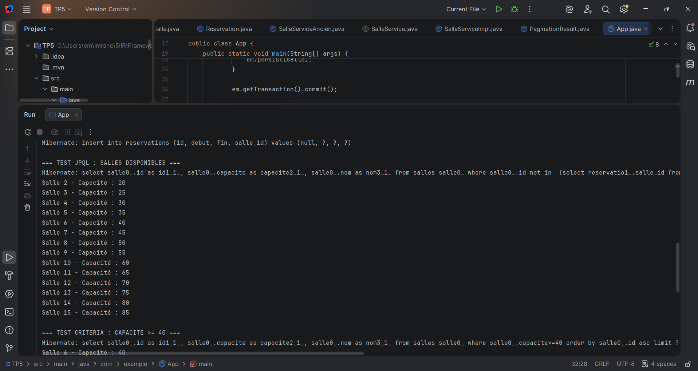
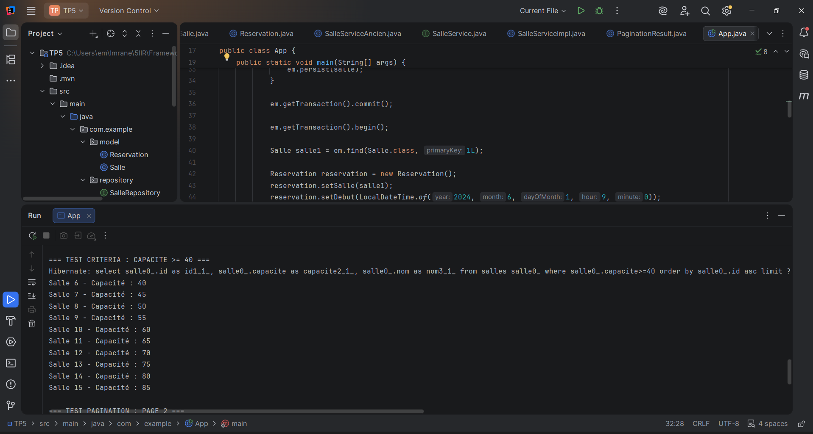
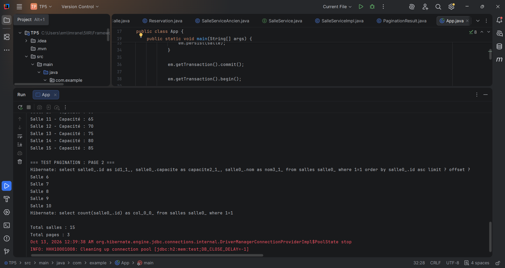

# TP5 — Requêtes avancées JPA/JPQL et pagination

## 1. Objectif

Ce TP a pour objectif de développer une application Java de gestion des salles et de leurs réservations en utilisant JPA et Hibernate.

Il permet de mettre en pratique les requêtes JPQL, la recherche multicritère avec Criteria API et la pagination côté serveur.

## 2. Technologies utilisées

- Java
- Maven
- JPA / Hibernate
- H2 Database
- JPQL et Criteria API
- IntelliJ IDEA

## 3. Fonctionnalités réalisées

- Création des entités `Salle` et `Reservation` avec une relation OneToMany / ManyToOne.
- Recherche des salles disponibles sur un créneau horaire avec JPQL.
- Recherche dynamique par nom, capacité minimale et disponibilité avec Criteria API.
- Pagination des résultats avec `setFirstResult()` et `setMaxResults()`.
- Calcul du nombre total d'éléments et de pages.
- Organisation du code en couches Repository et Service.
- Création de la classe générique `PaginationResult<T>`.

## 4. Exécution et résultats

### 4.1. Recherche des salles disponibles avec JPQL

La requête JPQL permet de récupérer les salles disponibles pendant un créneau donné. Dans notre test, la salle 1 est réservée entre 9h et 11h. Elle est donc exclue des résultats, contrairement aux salles 2 à 15.

### 4.2. Recherche multicritère avec Criteria API

L'API Criteria permet d'appliquer dynamiquement des filtres sur les salles. Dans cet exemple, la recherche sélectionne uniquement les salles ayant une capacité supérieure ou égale à 40 personnes.

### 4.3. Pagination des résultats

La pagination permet de limiter le nombre de salles retournées par requête. Avec 15 salles et une taille de page de 5 éléments, l'application calcule 3 pages. La deuxième page affiche les salles 6 à 10.

## 5. Conclusion

Ce TP a permis de maîtriser les requêtes JPQL, la construction de recherches dynamiques avec Criteria API et la pagination des résultats. L'utilisation des couches Repository et Service permet également de mieux organiser l'accès aux données et la logique métier.